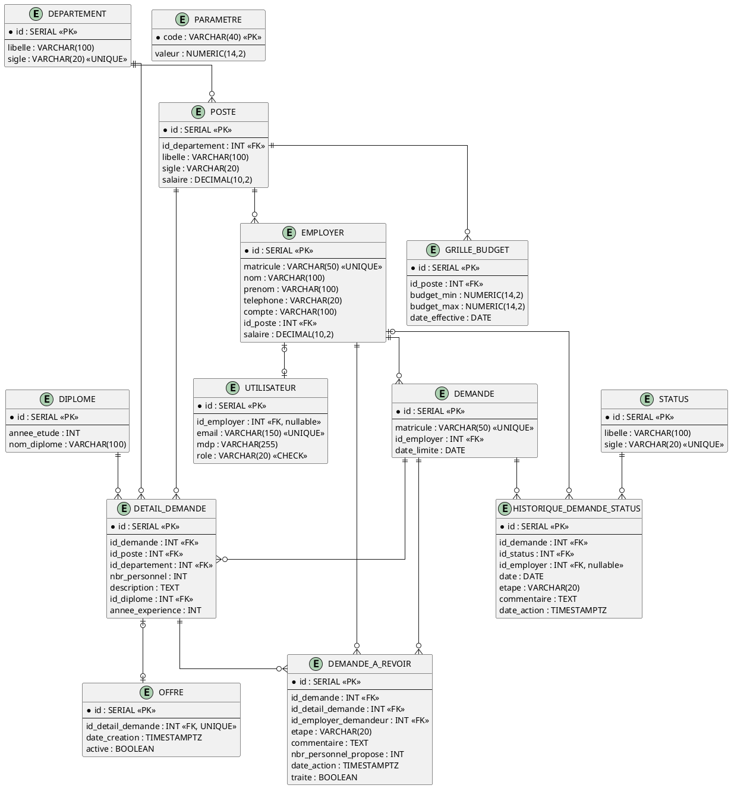

# 📊 MCD — Base de données `gestion_entreprise`

> Schéma conceptuel prêt à copier dans votre rapport / wiki / README.

---

## 1. Entités et attributs

### 🏢 DEPARTEMENT
| Attribut | Type | Contrainte |
|---|---|---|
| `id` | SERIAL | **PK** |
| `libelle` | VARCHAR(100) | NOT NULL |
| `sigle` | VARCHAR(20) | NOT NULL, **UNIQUE** |

### 💼 POSTE
| Attribut | Type | Contrainte |
|---|---|---|
| `id` | SERIAL | **PK** |
| `id_departement` | INT | **FK → DEPARTEMENT(id)** |
| `libelle` | VARCHAR(100) | NOT NULL |
| `sigle` | VARCHAR(20) | NOT NULL |
| `salaire` | DECIMAL(10,2) | |

### 👷 EMPLOYER
| Attribut | Type | Contrainte |
|---|---|---|
| `id` | SERIAL | **PK** |
| `matricule` | VARCHAR(50) | NOT NULL, **UNIQUE** |
| `nom` | VARCHAR(100) | NOT NULL |
| `prenom` | VARCHAR(100) | NOT NULL |
| `telephone` | VARCHAR(20) | |
| `compte` | VARCHAR(100) | |
| `id_poste` | INT | **FK → POSTE(id)** |
| `salaire` | DECIMAL(10,2) | |

### 👤 UTILISATEUR
| Attribut | Type | Contrainte |
|---|---|---|
| `id` | SERIAL | **PK** |
| `id_employer` | INT | **FK → EMPLOYER(id)**, *nullable* |
| `email` | VARCHAR(150) | NOT NULL, **UNIQUE** |
| `mdp` | VARCHAR(255) | NOT NULL |
| `role` | VARCHAR(20) | NOT NULL, CHECK ∈ {`CANDIDAT`, `MANAGER`, `RH`, `FINANCE`, `DG`} |

### 📌 STATUS
| Attribut | Type | Contrainte |
|---|---|---|
| `id` | SERIAL | **PK** |
| `libelle` | VARCHAR(100) | NOT NULL |
| `sigle` | VARCHAR(20) | NOT NULL, **UNIQUE** |

> Valeurs : `CREE`, `VALIDE`, `REFUSE`, `ABANDONNE`, `EXPIRE`.

### 📄 DEMANDE
| Attribut | Type | Contrainte |
|---|---|---|
| `id` | SERIAL | **PK** |
| `matricule` | VARCHAR(50) | NOT NULL, **UNIQUE** |
| `id_employer` | INT | **FK → EMPLOYER(id)** |
| `date_limite` | DATE | |

### 🎓 DIPLOME
| Attribut | Type | Contrainte |
|---|---|---|
| `id` | SERIAL | **PK** |
| `annee_etude` | INT | NOT NULL |
| `nom_diplome` | VARCHAR(100) | NOT NULL |

### 📋 DETAIL_DEMANDE
| Attribut | Type | Contrainte |
|---|---|---|
| `id` | SERIAL | **PK** |
| `id_demande` | INT | **FK → DEMANDE(id)** |
| `id_poste` | INT | **FK → POSTE(id)** |
| `id_departement` | INT | **FK → DEPARTEMENT(id)** |
| `nbr_personnel` | INT | NOT NULL |
| `description` | TEXT | *(ancien `motif`)* |
| `id_diplome` | INT | **FK → DIPLOME(id)** |
| `annee_experience` | INT | NOT NULL |

### 🕓 HISTORIQUE_DEMANDE_STATUS
| Attribut | Type | Contrainte |
|---|---|---|
| `id` | SERIAL | **PK** |
| `id_demande` | INT | **FK → DEMANDE(id)** |
| `id_status` | INT | **FK → STATUS(id)** |
| `id_employer` | INT | **FK → EMPLOYER(id)**, *nullable* |
| `date` | DATE | NOT NULL, DEFAULT `CURRENT_DATE` |
| `etape` | VARCHAR(20) | NOT NULL, DEFAULT `CREATION` |
| `commentaire` | TEXT | |
| `date_action` | TIMESTAMPTZ | NOT NULL, DEFAULT `CURRENT_TIMESTAMP` |

### 🔍 DEMANDE_A_REVOIR
| Attribut | Type | Contrainte |
|---|---|---|
| `id` | SERIAL | **PK** |
| `id_demande` | INT | **FK → DEMANDE(id)** |
| `id_detail_demande` | INT | **FK → DETAIL_DEMANDE(id)** |
| `id_employer_demandeur` | INT | **FK → EMPLOYER(id)** |
| `etape` | VARCHAR(20) | NOT NULL |
| `commentaire` | TEXT | NOT NULL |
| `nbr_personnel_propose` | INT | |
| `date_action` | TIMESTAMPTZ | NOT NULL, DEFAULT `CURRENT_TIMESTAMP` |
| `traite` | BOOLEAN | NOT NULL, DEFAULT `FALSE` |

### 📢 OFFRE
| Attribut | Type | Contrainte |
|---|---|---|
| `id` | SERIAL | **PK** |
| `id_detail_demande` | INT | **FK → DETAIL_DEMANDE(id)**, **UNIQUE** |
| `date_creation` | TIMESTAMPTZ | NOT NULL, DEFAULT `CURRENT_TIMESTAMP` |
| `active` | BOOLEAN | NOT NULL, DEFAULT `TRUE` |

### 💰 GRILLE_BUDGET
| Attribut | Type | Contrainte |
|---|---|---|
| `id` | SERIAL | **PK** |
| `id_poste` | INT | **FK → POSTE(id)** |
| `budget_min` | NUMERIC(14,2) | NOT NULL, `>= 0` |
| `budget_max` | NUMERIC(14,2) | NOT NULL, `>= budget_min` |
| `date_effective` | DATE | NOT NULL |

### ⚙️ PARAMETRE
| Attribut | Type | Contrainte |
|---|---|---|
| `code` | VARCHAR(40) | **PK** |
| `valeur` | NUMERIC(14,2) | NOT NULL |

---

## 2. Associations et cardinalités

| Association | Entité 1 | Card. | Entité 2 | Card. | Description |
|---|---|---|---|---|---|
| **Contient** | DEPARTEMENT | 1,N | POSTE | 1,1 | Un poste appartient à un département |
| **Occupe** | POSTE | 1,1 | EMPLOYER | 1,N | Un employé occupe un poste |
| **Possède** | EMPLOYER | 0,1 | UTILISATEUR | 1,1 | Un employé peut avoir 0 ou 1 compte |
| **Émet** | EMPLOYER | 1,N | DEMANDE | 1,1 | Un employé émet plusieurs demandes |
| **Détaille** | DEMANDE | 1,N | DETAIL_DEMANDE | 1,1 | Une demande contient plusieurs lignes |
| **Concerne** | DETAIL_DEMANDE | 1,N | POSTE | 1,1 | Chaque ligne vise un poste |
| **Situe** | DETAIL_DEMANDE | 1,N | DEPARTEMENT | 1,1 | Département concerné par la ligne |
| **Requiert** | DETAIL_DEMANDE | 1,N | DIPLOME | 1,1 | Diplôme requis pour la ligne |
| **Historise** | DEMANDE | 1,N | HISTORIQUE_DEMANDE_STATUS | 1,1 | Journal des changements |
| **Porte** | HISTORIQUE_DEMANDE_STATUS | 1,N | STATUS | 1,1 | Statut à un instant donné |
| **Évalue** | EMPLOYER | 0,N | HISTORIQUE_DEMANDE_STATUS | 1,1 | Évaluateur (nullable) |
| **Signale** | DEMANDE | 1,N | DEMANDE_A_REVOIR | 1,1 | Demandes à revoir |
| **Cible** | DETAIL_DEMANDE | 1,N | DEMANDE_A_REVOIR | 1,1 | Ligne concernée |
| **Propose** | EMPLOYER | 1,N | DEMANDE_A_REVOIR | 1,1 | Employé demandeur |
| **Publie** | DETAIL_DEMANDE | 0,1 | OFFRE | 1,1 | Une ligne → au plus une offre |
| **Tarife** | POSTE | 1,N | GRILLE_BUDGET | 1,1 | Grille budgétaire par poste |
| **Paramètre** | PARAMETRE | — | — | — | Table clé/valeur autonome |

---

## 3. Diagramme relationnel (texte)

```
DEPARTEMENT (id, libelle, sigle)
    │
    └──< POSTE (id, id_departement, libelle, sigle, salaire)
              │
              ├──< EMPLOYER (id, matricule, nom, prenom, telephone, compte, id_poste, salaire)
              │         │
              │         ├──o UTILISATEUR (id, id_employer, email, mdp, role)
              │         │
              │         ├──< DEMANDE (id, matricule, id_employer, date_limite)
              │         │         │
              │         │         ├──< DETAIL_DEMANDE (id, id_demande, id_poste, id_departement,
              │         │         │                     nbr_personnel, description,
              │         │         │                     id_diplome, annee_experience)
              │         │         │         │
              │         │         │         ├──o OFFRE (id, id_detail_demande, date_creation, active)
              │         │         │         │
              │         │         │         └──< DEMANDE_A_REVOIR (id, id_demande, id_detail_demande,
              │         │         │                               id_employer_demandeur, etape,
              │         │         │                               commentaire, nbr_personnel_propose,
              │         │         │                               date_action, traite)
              │         │         │
              │         │         └──< HISTORIQUE_DEMANDE_STATUS (id, id_demande, id_status,
              │         │                                          id_employer, date, etape,
              │         │                                          commentaire, date_action)
              │         │                      │
              │         │                      └──> STATUS (id, libelle, sigle)
              │         │
              │         └──< DEMANDE_A_REVOIR (id_employer_demandeur)
              │
              └──< GRILLE_BUDGET (id, id_poste, budget_min, budget_max, date_effective)

DIPLOME (id, annee_etude, nom_diplome) ──< DETAIL_DEMANDE (id_diplome)

PARAMETRE (code, valeur)   [table autonome]
```

---

## 4. Vues

### `v_historique_demande_status`
Jointure de `HISTORIQUE_DEMANDE_STATUS` + `DEMANDE` + `STATUS` + `EMPLOYER`.
Expose : `id`, `id_demande`, `id_status`, `id_employer_evaluateur`, `nom_evaluateur`, `prenom_evaluateur`, `matricule`, `id_employer`, `libelle`, `date`.

### `v_demande_statut_courant`
Dernier historique par demande (`DISTINCT ON id_demande ORDER BY id DESC`).
Expose : `id`, `id_demande`, `id_status`, `id_employer`, `etape`, `commentaire`, `date_action`.

---

## 5. Contraintes clés

| Contrainte | Table | Détail |
|---|---|---|
| `ck_utilisateur_role` | `utilisateur` | `role ∈ {CANDIDAT, MANAGER, RH, FINANCE, DG}` |
| `ux_departement_sigle` | `departement` | `sigle` UNIQUE |
| `ux_status_sigle` | `status` | `sigle` UNIQUE |
| `ux_utilisateur_email` | `utilisateur` | `email` UNIQUE |
| `ux_employer_matricule` | `employer` | `matricule` UNIQUE |
| `ux_demande_matricule` | `demande` | `matricule` UNIQUE |
| `ux_offre_detail` | `offre` | `id_detail_demande` UNIQUE |
| `ck_grille_budget` | `grille_budget` | `budget_min >= 0 AND budget_max >= budget_min` |
| `ix_historique_demande_id` | `historique_demande_status` | Index `(id_demande, id DESC)` |
| `fk_detail_demande_diplome` | `detail_demande` | `id_diplome` → `diplome(id)` |

---

## 6. Rôles utilisateurs

| Rôle | Description |
|---|---|
| `CANDIDAT` | Utilisateur externe (pas d'`id_employer`), postule aux offres |
| `MANAGER` | Employé qui crée des demandes de recrutement |
| `RH` | Valide / refuse les demandes, publie les offres |
| `FINANCE` | Valide le budget des demandes |
| `DG` | Validation finale (Direction Générale) |

---

## 7. Code PlantUML (pour générer l'image)



---

## 8. Points d'attention

1. **`detail_demande.id_departement`** est redondant avec `poste.id_departement` → risque d'incohérence.
2. **`demande.id_employer`** = demandeur ; **`historique_demande_status.id_employer`** = évaluateur.
3. **`utilisateur.id_employer` nullable** : obligatoire pour les candidats, mais non contraint par le rôle en base.
4. **`offre` ↔ `detail_demande`** : relation 1-1 (UNIQUE) — une offre par ligne de demande.
5. **`status.sigle`** a été migré de `CR/AC/AU/RF/AR/AN` vers `CREE/VALIDE/REFUSE/ABANDONNE/EXPIRE`.

---

Besoin que je génère aussi :
- le **MLD** (Modèle Logique avec toutes les FK détaillées),
- le **diagramme de cas d'utilisation** par rôle,
- ou un **`README.md`** complet du projet avec ce schéma intégré ?